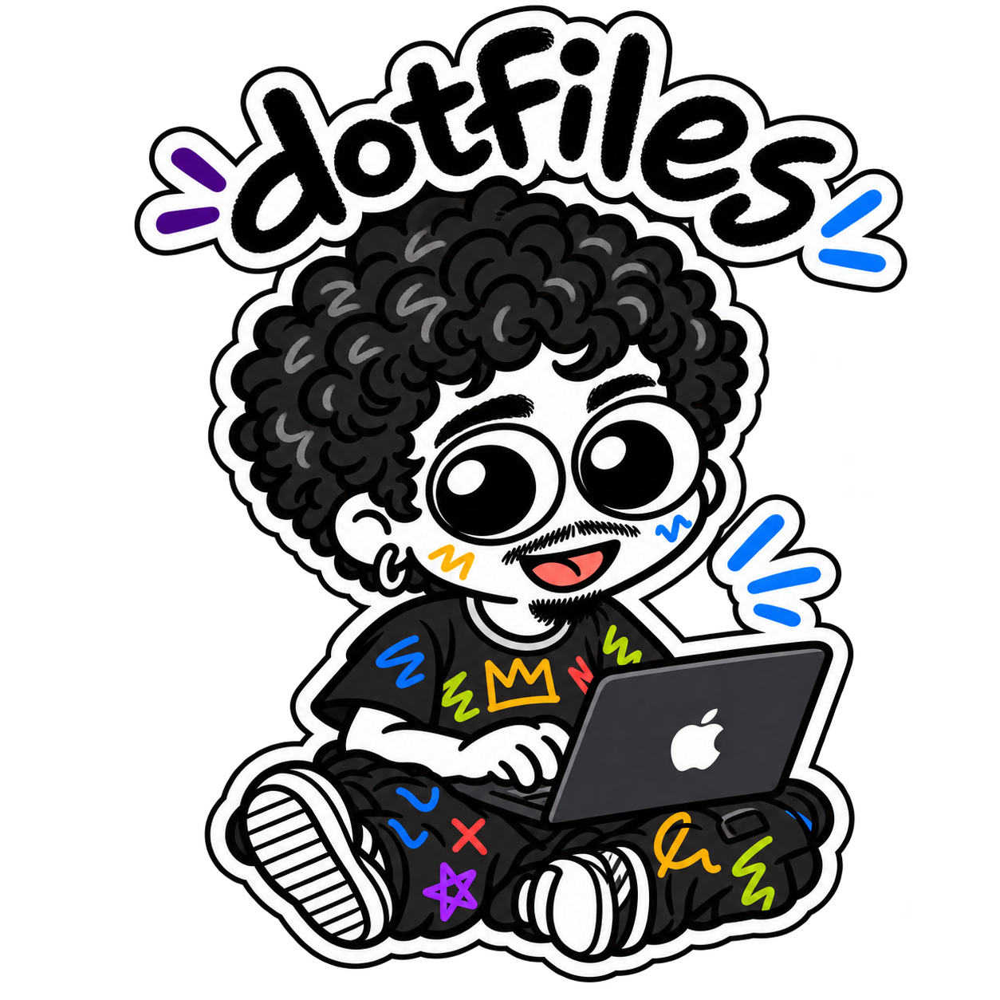

my everyday macOS setup.<br>
for building software and making things.

<br clear="right">

#### what's inside

eight modules, picked one by one. the first four install software; the
other four apply configuration and bring the software it needs.

```
apps     desktop apps, Proton
dev      runtimes, CLIs, Rust
ai       AI apps and CLIs
content  OBS, Blender, Descript, CapCut
shell    zsh, Starship, iTerm2
git      Git settings, identities
vscode   VS Code and extensions
nvim     Neovim and language servers
```

#### set it up

made for macOS on Apple Silicon, with Homebrew in `/opt/homebrew`. you need
the Command Line Tools and an administrator account; `setup` installs Homebrew
if it is missing.

```sh
xcode-select --install
sh -c "$(curl -fsLS get.chezmoi.io)" \
  -- init RaioViajante
cd ~/.local/share/chezmoi
./setup --help
```

`init` only clones the repository. nothing is installed or applied until you
name a module:

```sh
# one module: software + configuration
./setup nvim

# software only
./setup --packages-only dev ai

# configuration only
./setup --no-packages shell git

# preview everything, change nothing
./setup --dry-run all

# everything
./setup all
```

each module is checked in isolated environments; a complete install on a clean
Mac has not been run end to end. the full guide is in
[docs/setup.md](docs/setup.md).

#### read next

<pre>
<a href="docs/setup.md">setup.md</a> ·············· modules, modes
<a href="docs/apps.md">apps.md</a> ··············· desktop apps
<a href="docs/development.md">development.md</a> ········ runtimes, Rust
<a href="docs/ai.md">ai.md</a> ················· AI apps, CLIs
<a href="docs/content-creation.md">content-creation.md</a> ··· OBS, Descript, CapCut
<a href="docs/shell-and-terminal.md">shell-and-terminal.md</a> · zsh, iTerm2
<a href="docs/git.md">git.md</a> ················ identity, SSH
<a href="docs/vscode.md">vscode.md</a> ············· extensions
<a href="docs/neovim.md">neovim.md</a> ············· plugins, LSP
</pre>

#### make it yours

- pick only the modules you want; each one touches only its own files, and
  `chezmoi apply` never installs anything.
- packages live in `brew/*.Brewfile` and extensions in `manifests/`; edit them
  or [skip some for one run](docs/setup.md#customize-or-omit-components).
- keeping your own shell works too:
  [add these PATH entries](docs/setup.md#using-modules-with-your-own-shell).
- no Git identity is versioned. your name and email live in untracked files
  ([git.md](docs/git.md)).
- credentials, SSH keys and app or AI sign-ins are set up by hand, outside this
  repository ([git.md](docs/git.md), [ai.md](docs/ai.md)).

#### license

<pre>
code ·················· <a href="LICENSE">MIT</a>
</pre>
